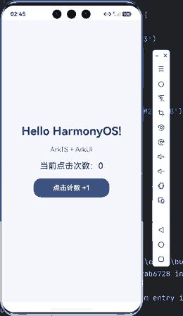
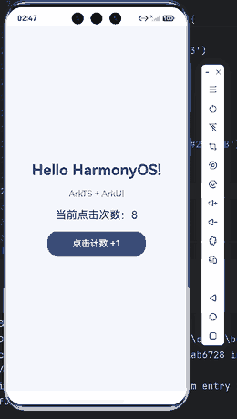

# 实验01：移动开发环境搭建与端实现

**实验项目：HarmonyOS (ArkTS + ArkUI) — Hello World**

本项目是 DevEco Studio 创建的 HarmonyOS Stage 模型应用，使用 ArkTS 与 ArkUI 实现 Hello World 页面以及点击计数。已在 HarmonyOS Phone 模拟器上运行验证。

## 开发与运行环境

- 操作系统：Windows
- IDE：HUAWEI DevEco Studio
- 应用模型：Stage / EntryAbility
- 开发语言：ArkTS
- UI 框架：ArkUI（声明式）
- 编译配置：target SDK 26.0.0，compatible SDK 6.1.1(24)
- 运行设备：HarmonyOS 手机模拟器

## 实验目标与完成情况

1. **环境搭建**：安装 DevEco Studio 和 HarmonyOS SDK，完成依赖同步与模拟器配置。
2. **创建工程**：创建 MyApplication，识别入口、页面、配置文件。
3. **Hello World**：使用 ArkUI 的 `Column`、`Text` 和 `Button` 声明界面并运行于模拟器。
4. **状态 + 视图**：使用 `@State count` 和 `onClick`，点击按钮后计数自动刷新。UniApp 使用 Vue 状态管理，Flutter 可用 `setState` 等机制，写法不同但均是状态驱动 UI。
5. **版本控制**：通过 GitHub 提交完整工程与运行效果截图。

## 项目目录说明

| 文件/目录 | 作用 |
|---|---|
| `entry/src/main/ets/entryability/EntryAbility.ets` | UIAbility 应用入口；处理生命周期和窗口加载 |
| `entry/src/main/ets/pages/Index.ets` | 首页；声明式 UI 与点击计数器 |
| `entry/src/main/module.json5` | 模块、Ability 与页面配置 |
| `AppScope/app.json5` | 应用包名、版本等全局配置 |
| `entry/src/main/resources/base/profile/main_pages.json` | 页面路由 |
| `build-profile.json5` | SDK 与产品构建设置 |
| `oh-package.json5` | 依赖声明 |
| `hvigorfile.ts` | 构建系统入口 |
| `screenshots/` | 模拟器运行效果截图 |

## 关键代码

```ts
@State count: number = 0;

Text(`当前点击次数：${this.count}`)

Button('点击计数 +1')
  .onClick(() => {
    this.count++;
  })
```

`@State` 标注可观察状态，按钮点击使 `count` 增加，ArkUI 自动更新显示该值的文本。

## 运行效果

初始界面（计数为 0）：



点击计数八次后：



## 运行步骤

1. 用 DevEco Studio 打开仓库根目录。
2. 安装或同步工程要求的 HarmonyOS SDK 与依赖。
3. 打开 **Tools → Device Manager**，启动 HarmonyOS Phone 模拟器。
4. 顶部选择 `entry` 和运行设备，点击 **Run**。
5. 点击“点击计数 +1”，确认页面上的次数从 0 递增。

> 仓库不包含编译缓存、依赖缓存或本机配置文件。这些文件应在开发者本机重新生成。
